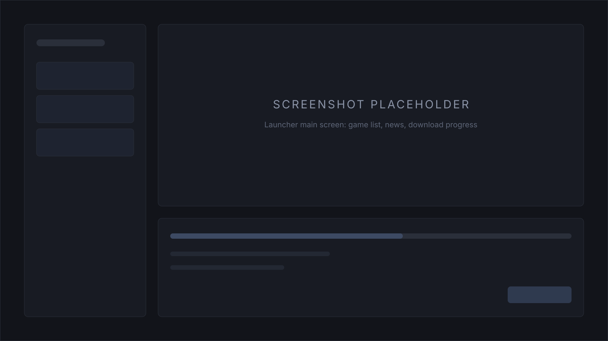

# Chill Hub

Русский · [English](README.en.md)

[](https://github.com/samoy-love/chillhub/actions/workflows/ci.yml)
[](https://codecov.io/gh/samoy-love/chillhub)
[](https://launcher.samoy.love)
[](LICENSE)

Лаунчер для Windows, который раздаёт сборки игр с модами небольшому кругу
игроков и держит их в актуальном состоянии —
[launcher.samoy.love](https://launcher.samoy.love).

Обновить модпак должно значить «Обновить → Играть», а не «скачай архив,
распакуй сюда, эти три файла удали, а свой конфиг не потеряй». Каждый ручной
шаг в этой цепочке кто-нибудь однажды сделает не так, а сломанная установка
неотличима от сломанной сборки, пока в этом не разберутся руками.

Chill Hub вырос из приватного апдейтера модов для Lethal Company (C#, WinForms,
2023–2024): одна игра, зашитый список файлов, обновление лилось поверх того,
что лежало. Та же задача, пересобранная под много игр — с диффами, хешами
и откатами.



## Как устроено

**Обновления идут диффом.** Сервер публикует манифест версии (пути, размеры,
хеши Blake3 и SHA-256), клиент сверяет его с тем, что лежит на диске, и качает
только разницу — в несколько потоков через HTTP Range, с докачкой после
обрыва связи. В итоге папка игры — точная копия опубликованной версии, а
переход на любую версию, включая откат, стоит того же диффа, а не полной
перекачки.

**Модпаки собирает сервер, а не игрок.** Модпак на Thunderstore — это почти
пустой пакет со списком зависимостей: скачать его целиком значит получить
девять мегабайт, в которых нет ни одного мода. Настоящий набор — это обход
дерева зависимостей, полторы сотни пакетов и гигабайты файлов, разложенные по
правилам конкретной игры. Сервер делает эту работу один раз на всех и
публикует результат обычной версией — с тем же манифестом, диффом и откатом,
что и сборка игры. Игроку остаётся выбрать, что запустить: свою копию из Steam
или сборку Chill Hub, с модами или без. Подробности — в
[docs/modpacks.md](docs/modpacks.md).

**Себя лаунчер обновляет отдельным exe**, потому что запущенный
процесс не может переписать собственные файлы. Пользовательские данные из-за
этого живут в `%APPDATA%\ChillHub`, а не рядом с бинарями.

**Ничего не подписано** — это решение, а не упущение: подлинность держится на
TLS, SmartScreen предупреждает при установке, пока не наберётся репутация
загрузок. Установщик пользовательский (NSIS, без прав администратора).

Детали — форматы манифеста, диффовый алгоритм, preserve-правила апдейтера,
проверка целостности — в [docs/spec.md](docs/spec.md).

## Стек

**Клиент** разрабатывается на Rust со Slint в `launcher/ChillHub.Native/`.
В этой ветке из него собираются лаунчер, отдельный апдейтер и помощник для
настроек безопасности. Переход пользователей на Rust-сборку ещё впереди.
Прежний клиент на C# WPF и его апдейтер остаются эталоном совместимости.

**Сервер** — Go, два независимых бинаря: публичный API (игры, версии,
манифесты, новости) и админский (приём ZIP-сборок, реестр игр, сборка модпаков
с Thunderstore, новости, техработы, метрики, обратная связь). Оба слушают
только loopback. Морда админки — vanilla JS без сборщика.

**Прод** — systemd-юниты за системным nginx, атомарные релизы с откатом через
[deploy-kit](https://github.com/samoy-love/deploy-kit). Один хост раздаёт всё:
`/` — лендинг, `/api/*` — публичный API, `/admin/api/*` и `/admin/ui/*` —
админка, `/content/*` и `/downloads/*` — сборки, их отдаёт nginx напрямую.

## Быстрый старт

Для Native нужны PowerShell 7, Rust для Windows MSVC и Windows SDK.
Для сервера нужен Go 1.26+, для веб-тестов — Node 24.

```powershell
.\launcher\ChillHub.Native\build.ps1
.\scripts\run-admin.ps1
```

Команды проверки запускаются из корня репозитория.

```powershell
.\scripts\native-ci.ps1 -ValidationOnly
npm ci
node --test tests/web/*.test.js
```

## Структура

| Путь | Назначение |
|---|---|
| `launcher/ChillHub.Native/` | Клиент Rust и Slint, апдейтер, помощник для настроек безопасности |
| `launcher/ChillHub/`, `updater/` | Прежний C#-клиент и апдейтер для сравнения поведения |
| `server/cmd/api` | Публичный API |
| `server/cmd/admin` | Админ-API: приём сборок, активация `latest`, реестр, модпаки, новости, техработы |
| `server/admin_ui/` | Веб-морда админки |
| `landing/` | Лендинг на корне домена |
| `content/` | Манифесты, файлы версий, новости, состояние техработ |
| `scripts/` | Запуск для разработки, сборка установщика, NSIS-скрипт |
| `.deploy-kit/` | Описания целей выкатки |
| `docs/` | [Спецификация](docs/spec.md), [модпаки](docs/modpacks.md), [оформление](docs/design.md), [конфигурация](docs/configuration.md), [установщик](docs/installer.md), [политика безопасности](docs/SECURITY.md) |

## Тесты

CI проверяет форматирование, Clippy, тесты Rust и установку Native на чистой
Windows. Сервер проходит `go vet`, `go test -race` и golangci-lint, веб-часть —
`node --test`, ESLint, Stylelint и HTMLHint. Покрытие публикуется в Codecov.
Тесты xUnit относятся к прежнему клиенту.

## Выкатка

Пять целей катятся по отдельности — лендинг, публичный API, админ-сервер,
морда админки и установщик — через
[deploy-kit](https://github.com/samoy-love/deploy-kit). Установщик пересобирается
каждым мержем, задевшим клиента: exe подменяется на сайте
(`/downloads/ChillHub-Setup.exe`), сборка самообновления уезжает в админку;
активной её делает переключение latest в админке — руками.

```bash
dk                          # что сейчас на проде
dk deploy chillhub-api      # только публичный API
dk deploy --all --dry-run   # посмотреть план, ничего не трогая
dk rollback chillhub-admin
```

В Actions → Deploy → Run workflow можно запустить `installer` отдельно.
Вариант `all` включает установщик. При мерже в `main` затронутые цели
определяет задача `changes`.

При изменении файлов, из которых собирается релиз Native, поднимите
`version` в `launcher/ChillHub.Native/Cargo.toml`. Проверка
`Launcher version bump` сверяет, что номер ещё свободен.

Пароль админки хранится хешем в systemd drop-in и задаётся отдельно от
выкатки: он меняется редко, а провозить секрет через каждый деплой — лишний
повод его потерять. Контент — сборки, новости, обращения — снимает
`deploy/backup-content.sh` по systemd-таймеру; этих данных нет больше нигде.

## Часть samoy.love

Домен читается как фамилия владельца — Самойлов. Все перечисленные проекты
живут на одном хосте и катятся одним пайплайном.

| Проект | Что это |
|---|---|
| [launcher.samoy.love](https://launcher.samoy.love) | Этот лаунчер — [samoy-love/chillhub](https://github.com/samoy-love/chillhub) |
| [snakes.samoy.love](https://snakes.samoy.love) | Браузерная игра в захват территории — [samoy-love/snakes](https://github.com/samoy-love/snakes) |
| [metro.samoy.love](https://metro.samoy.love) | Офлайн-PWA со схемой московского метро — [samoy-love/metro-map](https://github.com/samoy-love/metro-map) |
| [status.samoy.love](https://status.samoy.love) | Статус сервисов: агент на хосте, бот в Telegram и внешний сторож — [samoy-love/status.samoy.love](https://github.com/samoy-love/status.samoy.love) |
| [samoy.love](https://samoy.love) | Личная страница — [samoy-love/samoy.love](https://github.com/samoy-love/samoy.love) |
| Мониторинг | [samoy-love/metrics.samoy.love](https://github.com/samoy-love/metrics.samoy.love) — мониторинг всей экосистемы; оба бинаря Chill Hub отдают ему метрики в формате Prometheus на loopback |
| Пайплайн | [samoy-love/deploy-kit](https://github.com/samoy-love/deploy-kit) — общий релизный пайплайн для всех перечисленных |

## Контакты и лицензия

Алексей Самойлов — [alex@samoy.love](mailto:alex@samoy.love),
[t.me/tr0llex](https://t.me/tr0llex). Сообщения об уязвимостях —
[docs/SECURITY.md](docs/SECURITY.md). Задачи и планы — в
[issues](https://github.com/samoy-love/chillhub/issues).

MIT, см. [LICENSE](LICENSE).
